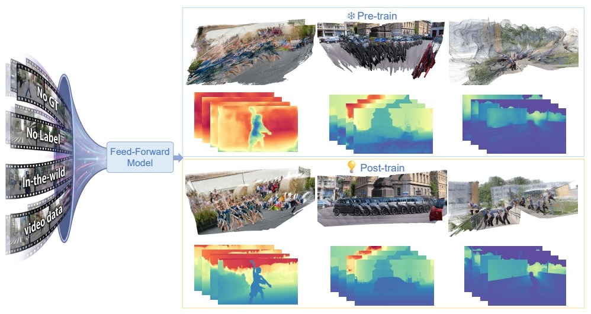
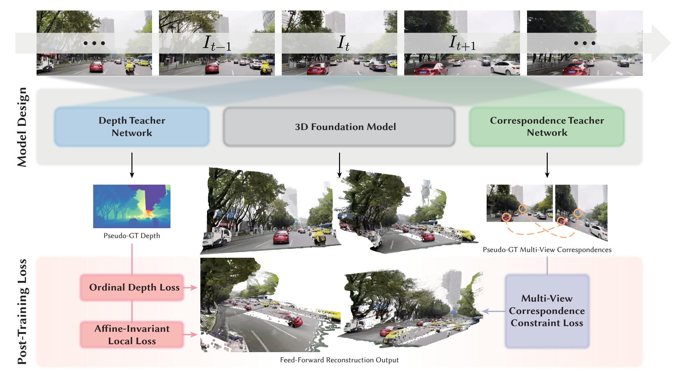

<div align="center">

<h2>PURE: Refining Feed-forward 3D Reconstruction with Unlabeled Post-training</h2>

<p>
  Yaolong Zhu<sup>1</sup>,
  <a href="https://penghtyx.github.io/yuki-lipeng/">Peng Li</a><sup>2</sup>,
  <a href="https://github.com/jiah-cloud">Jiahao Lu</a><sup>2,▲</sup>,
  <a href="https://afterjourney00.github.io/">Chengfeng Zhao</a><sup>2</sup>,
  Mengfei Li<sup>2</sup>,
  Chao Wang<sup>3</sup>,
  Wenyue Chen<sup>1</sup>,<br>
  Zekai Gu<sup>2</sup>,
  Chengwei Ren<sup>2</sup>,
  <a href="https://www.ece.pku.edu.cn/info/1046/2147.htm">Ronggang Wang</a><sup>1,✉</sup>,
  <a href="https://liuyuan-pal.github.io/">Yuan Liu</a><sup>2,✉</sup>
</p>

<p>
  <sup>1</sup> Guangdong Provincial Key Laboratory of Ultra High Definition Immersive Media Technology, Shenzhen Graduate School, Peking University
  &nbsp;&nbsp;
  <sup>2</sup> The Hong Kong University of Science and Technology
  &nbsp;&nbsp;
  <sup>3</sup> Pengcheng Laboratory
  <br>
  <sup>▲</sup> Project lead
  &nbsp;&nbsp;·&nbsp;&nbsp;
  <sup>✉</sup> Co-corresponding authors
</p>

<p>
  <a href="https://doi.org/10.1145/3767308.3836296"></a>
  &nbsp;&nbsp;
  <a href="https://arxiv.org/abs/2610.14698"></a>
  &nbsp;&nbsp;
  <a href="https://funnyguy525.github.io/PURE-Page/"></a>
  &nbsp;&nbsp;
  <a href="LICENSE"></a>
</p>

</div>

---

**PURE** post-trains a feed-forward 3D model on unlabeled video. Supervision comes from a monocular geometry teacher (MoGe), dynamic masks (Grounded SAM 2), and dense matches (GIM-RoMa). The architecture and the inference cost stay the same as the base model (VGGT, Pi3, or Depth Anything 3).



---

### 🖼️ Framework

<div align="center">
  
</div>

Given an unlabeled clip, the base model predicts depth and camera poses. PURE refines them with two branches: local geometry, using relative depth order and affine-invariant alignment to monocular pseudo points, and pose, using GIM-RoMa matches that pass dynamic, confidence, and cycle-consistency filters.

---

## ⚙️ Setup

```bash
git clone https://github.com/jiah-cloud/PURE.git
cd PURE
pip install -r requirements.txt
```

`requirements.txt` lists `torch>=2.1`. A CPU wheel is enough for the check below.

---

## 🎯 Objective

This repository releases the training objective. `SSLoss` is the loss used in the paper. `pure/utils` provides the geometry and alignment helpers it calls: depth edges, focal recovery, mask-aware resize, anchor sampling, and robust scale-and-shift alignment.

| Piece | Role |
| --- | --- |
| `pure/loss.py` | Ordinal depth, local affine-invariant geometry, and static correspondence, plus RoMa match filtering |
| `pure/utils/alignment.py` | Robust scale-and-shift alignment inside the geometry loss |
| `pure/utils/geometry.py` | Depth edges, focal recovery, mask-aware resize, and anchor sampling |

For one clip, the base model predicts camera-frame points, world points, depth, and poses. `SSLoss` applies three terms.

1. **Ordinal depth.** Random pixel pairs keep the teacher's depth order. The term does not depend on the teacher's absolute scale.
2. **Local affine-invariant geometry.** Inside local balls, predicted points are aligned to pseudo points `P = d_mono * K_pre^{-1} p` with a per-ball scale and shift. Surface detail transfers without copying the teacher's global scale.
3. **Static correspondence.** GIM-RoMa matches that survive the dynamic-mask, confidence, and cycle-consistency checks land on the same 3D point. Matches are sampled uniformly across the image.

```python
from pure import SSLoss, run_roma

criterion = SSLoss()
roma = run_roma(gim_roma, images, static_masks, dynamic_masks)  # or a precomputed dict
loss, details = criterion(predictions, batch, roma)
```

### Tensors

`predictions`

- `local_points`: `(B, S, H, W, 3)` camera-frame points
- `points`: `(B, S, H, W, 3)` world points used by the correspondence term

`batch`

- `depths`: `(B, S, H, W)` teacher depth
- `valid_masks`: `(B, S, H, W)` bool
- `dynamic_masks`: `(B, S, H, W)` bool, true on dynamic or sky pixels
- `distill_results["xy"]`: `(B, S, H, W, 2)` ray directions, so the pseudo points are `(xy * depth, depth)`

`run_roma` expects a module with `batch_match(img_a, img_b)` and `sample(matches, certainty, k)`, matching the GIM-RoMa interface used in training. A precomputed dictionary with the keys read in `SSLoss.correspondence_loss` is also accepted.

Dataloaders, backbone wrappers, and the distributed training loop are outside this release. The section below records the schedule from the paper.

---

## 🧪 Training setup

- Optimizer: AdamW, learning rate `1e-5`, weight decay `0.05`, betas `(0.9, 0.95)`
- Schedule: OneCycleLR, cosine, max learning rate `1e-5`
- 4× H800, gradient accumulation 2, gradient clip 1.0
- Views sampled from `[1, 24]`, aspect ratio in `[0.5, 2]`, about 160k–250k pixels
- VGGT: 12k iterations, intermediate global attention only, about 20 h
- Depth Anything 3: 5k iterations, same layer selection, about 8 h
- Pi3: replace the pixel-shuffle point head with a multi-level convolutional head, then 10k iterations of head initialization and 5k of joint post-training

Labeled synthetic data (OmniWorld, VKITTI, BEDLAM, PointOdyssey, Waymo) is mixed in to limit forgetting. The unlabeled real video is SpatialVID-HQ and Sekai-Real-Walking-HQ, about 5M frames.

---

## ✅ Check

```bash
python examples/smoke_test.py
```

The script builds a synthetic two-view plane, runs `SSLoss`, and backpropagates. It does not download teacher models.

---

## 📝 Citation

```bibtex
@inproceedings{zhu2026pure,
  author    = {Zhu, Yaolong and Li, Peng and Lu, Jiahao and Zhao, Chengfeng and Li, Mengfei and Wang, Chao and Chen, Wenyue and Gu, Zekai and Ren, Chengwei and Wang, Ronggang and Liu, Yuan},
  title     = {{PURE}: Refining Feed-forward {3D} Reconstruction with Unlabeled Post-training},
  booktitle = {Proceedings of the 34th ACM International Conference on Multimedia},
  series    = {MM '26},
  year      = {2026},
  publisher = {ACM},
  doi       = {10.1145/3767308.3836296},
  url       = {https://doi.org/10.1145/3767308.3836296}
}
```

---

## 🤝 Acknowledgements

PURE builds on [VGGT](https://github.com/facebookresearch/vggt), [Pi3](https://github.com/yyfz/Pi3), and [Depth Anything 3](https://github.com/ByteDance-Seed/Depth-Anything-3). Pseudo supervision uses [MoGe](https://github.com/microsoft/MoGe), [Grounded SAM 2](https://github.com/IDEA-Research/Grounded-SAM-2), and [GIM](https://github.com/xuelunshen/gim). The scale-and-shift solver follows [Track4World](https://github.com/TencentARC/Track4World).
