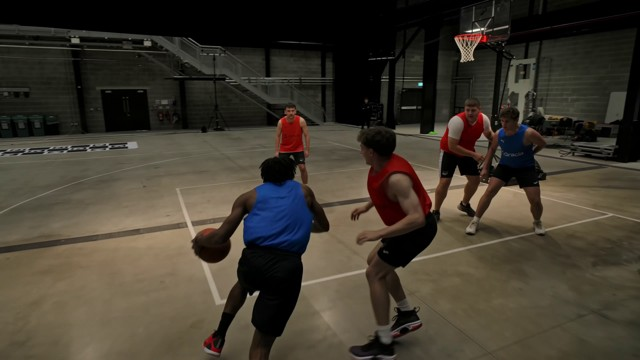
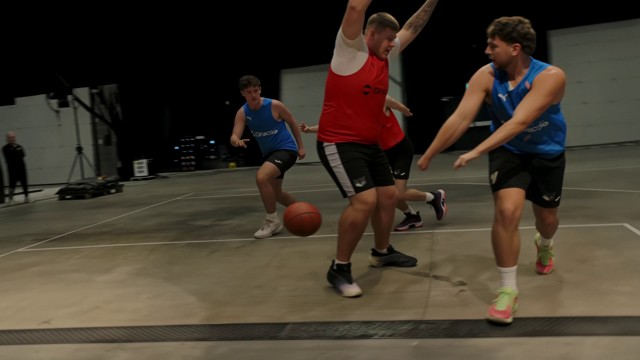

# Demo

**[Try these examples in PURE Studio](https://huggingface.co/spaces/cyun9286/PURE-Studio)**:
select one of the five example videos or the ten-image Drift-straight sequence,
then click **Reconstruct**. Example videos start with 16 consecutive frames;
the image example uses all ten images. You can change the model and frame count.

Motorcycle, Penguin, Sport and ten Drift-straight images come from
[SelfEvo](https://github.com/Self-Evo/SelfEvo). The two basketball inputs match
**Basketball close-up** and **Basketball wide view** on the
[project page](https://funnyguy525.github.io/PURE-Page/).
[sources.json](reconstruction/sources.json) records origins, sizes and SHA256
checksums, including the pinned SelfEvo revision. Input rights remain with their creators.

| Video example | Preview | Input |
| --- | --- | --- |
| Basketball close-up |  | [Original 4K video](basketball-close-up.mp4) |
| Basketball wide view |  | [Original 4K video](basketball-wide-view.mp4) |

Run from the repository root:

```bash
pip install -e '.[inference]'
bash scripts/demo/run_demo.sh --sample motorcycle --model pi3
bash scripts/demo/run_demo.sh --sample basketball-close-up --model pi3
bash scripts/demo/run_demo.sh --sample basketball-wide-view --model pi3
bash scripts/demo/run_demo.sh --sample all --model all
```

Select `motorcycle`, `penguin`, `sport`, `basketball-close-up`,
`basketball-wide-view` or `drift-straight` with `--sample`,
and `pi3`, `da3` or `vggt` with `--model`. Video runs use the first 48 consecutive
frames; drift-straight uses all ten supplied images.

Results go to `outputs/demo/<sample>-<model>/`. Use a new `--output` directory
for another run, or `--dry-run` to inspect commands. [Runner options](../scripts/README.md).
